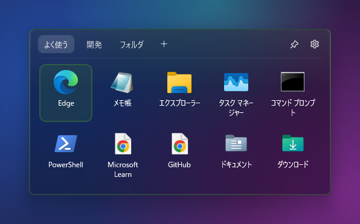
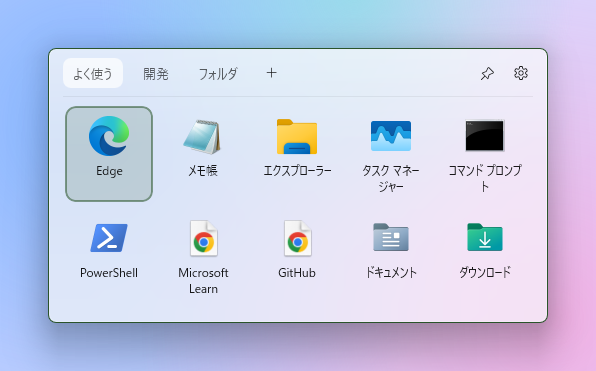
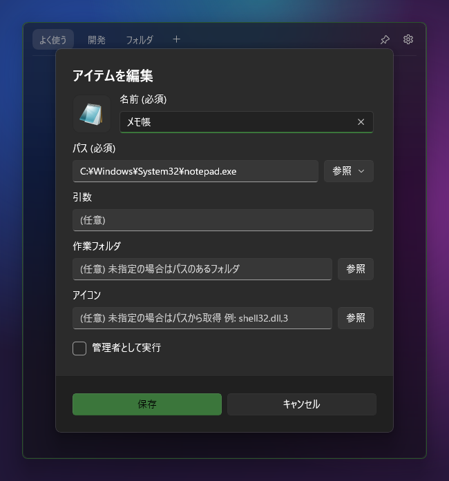
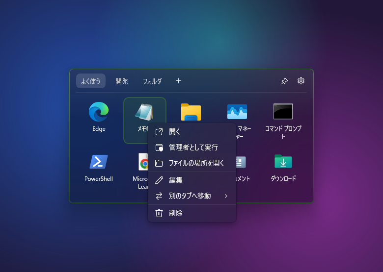
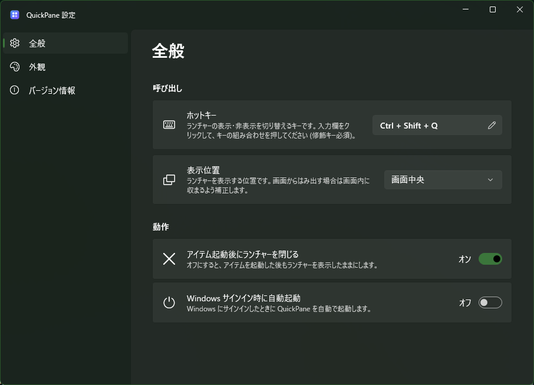
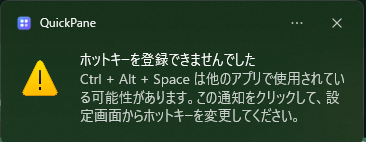
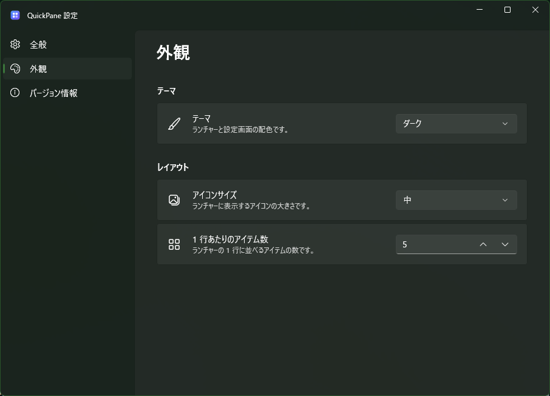

# QuickPane

ホットキーで呼び出せる、タスクトレイ常駐型の Windows 用アプリケーションランチャーです。
よく使うアプリ・ファイル・フォルダ・URL をタブで分けて登録しておき、どの作業中でもすぐに開けます。



## 主な機能

- タスクトレイに常駐し、グローバルホットキー (既定: `Ctrl + Space`) でランチャーを表示・非表示
- 登録したアイテム (アプリ・ファイル・フォルダ・URL) をタブ単位で管理し、クリックまたは `Enter` で起動
  - 管理者として実行 (UAC 昇格) に対応
  - ネットワーク上のパス (UNC パス `\\server\share\...`) も登録・起動可能
  - 起動に時間がかかる場合もランチャーは固まらず、失敗した場合は原因をランチャー内に表示
- エクスプローラからのドラッグ＆ドロップでアイテムを登録 (複数同時・ショートカット `.lnk` のリンク先読み取りに対応)
- ドラッグでアイテム・タブを並べ替え、アイテムをタブにドロップして移動
- キーボード操作 (矢印キー・`Enter`・`Ctrl + Tab`・`Esc`)
- アクリル (すりガラス風) の背景、ライト / ダークテーマ、マウスカーソル付近または画面中央への表示
- 設定画面でホットキー・表示位置・テーマ・アイコンサイズ・列数・起動後の動作・自動起動を変更 (即時反映)
- 設定と登録アイテムは exe と同じフォルダに保存 (インストール不要のポータブル運用)
- log4net によるログ出力 (設定ファイルで有効/無効、ログレベルを変更可能)

| ダークテーマ | ライトテーマ |
| --- | --- |
|  |  |

## 動作要件

| 項目 | 内容 |
| --- | --- |
| OS | Windows 10 (1809 以降) / Windows 11 (x64・ARM64)、Windows 11 推奨 |
| .NET ランタイム | .NET 10 Runtime |
| Windows App SDK ランタイム | Windows App SDK 1.8 Runtime |

ランタイムは exe に同梱していないため、事前にインストールしてください。

### .NET 10 Runtime

- ダウンロード: <https://dotnet.microsoft.com/download/dotnet/10.0>
  (「.NET Runtime 10.0.x」の Windows x64 インストーラ)
- または winget:

  ```bat
  winget install Microsoft.DotNet.Runtime.10
  ```

### Windows App SDK 1.8 Runtime

- ダウンロード: <https://learn.microsoft.com/windows/apps/windows-app-sdk/downloads>
  (「1.8」の Runtime installer `windowsappruntimeinstall-x64.exe`)
- または winget:

  ```bat
  winget install Microsoft.WindowsAppRuntime.1.8
  ```

ランタイムが未インストールの状態で起動すると、インストールを促すダイアログが表示されます。

> **Windows 10 の場合**
> ウィンドウの角丸は Windows 11 でのみ有効です。Windows 10 では角のないウィンドウで表示されます。
> アクリル背景を使用できない環境では、単色の背景で表示されます。

## 使用方法

ビルド成果物のフォルダ (`QuickPane/`) を任意の場所に配置し、`QuickPane.exe` を起動します。インストールは不要です。

1. 起動するとタスクトレイにアイコンが表示され、ランチャーは非表示の状態で待機します。
2. ホットキー (既定: `Ctrl + Space`) を押すと、マウスカーソル付近にランチャーが表示されます。
   もう一度押すと非表示になります。
3. タブを切り替え、アイテムをクリック (または選択して `Enter`) すると起動し、ランチャーは自動で閉じます。

ランチャーは次の場合にも閉じます。

- ランチャーの外をクリックした場合 (右上のピン留めボタンをオンにすると閉じなくなります)
- `Esc` キーを押した場合

既に起動中の状態で `QuickPane.exe` をもう一度起動した場合は、新しく起動せずに起動中のランチャーを表示します。

### タスクトレイ

- アイコンを左クリック: ランチャーを表示
- アイコンを右クリック: メニュー (ランチャーを表示 / 設定 / 終了)

QuickPane を終了するには、トレイアイコンの右クリックメニューから **終了** を選択します。

### キーボード操作

| キー | 動作 |
| --- | --- |
| 矢印キー | アイテムの選択を移動 |
| `Enter` | 選択中のアイテムを起動 |
| `Ctrl + Tab` / `Ctrl + Shift + Tab` | 次 / 前のタブに切り替え |
| `Esc` | ランチャーを閉じる |
| `Shift + F10` / アプリケーションキー | 選択中のアイテムの右クリックメニューを表示 |

### アイテムの登録方法

#### ドラッグ＆ドロップで登録する

エクスプローラからファイル・フォルダ・exe・ショートカット (`.lnk`) をランチャーにドロップすると、選択中のタブに登録されます。

- 複数のファイルをまとめてドロップできます。
- タブの上にドロップすると、そのタブに登録されます。
- ショートカットは、リンク先・引数・作業フォルダ・アイコンを読み取って登録します。

> ドラッグ中にランチャーが閉じてしまう場合は、ランチャー右上のピン留めボタンをオンにしてからドラッグしてください。

#### ダイアログで登録する

ランチャーの空白部分を右クリックし、**アイテムを追加** を選択するとアイテム編集ダイアログが表示されます。



| 項目 | 内容 |
| --- | --- |
| 名前 (必須) | ランチャーに表示する名前 |
| パス (必須) | ファイル・フォルダのフルパス、または URL (`https://...` 等)。**参照** ボタンからファイル・フォルダを選択することもできます。環境変数 (`%USERPROFILE%` 等) も使用できます。 |
| 引数 | 起動時に渡す引数 |
| 作業フォルダ | 起動時の作業フォルダ。未指定の場合はパスのあるフォルダ |
| アイコン | 表示するアイコン。未指定の場合はパスから自動で取得します。`.ico` / `.png` ファイル、または `.exe` / `.dll` とアイコン番号 (例: `shell32.dll,3`) を指定できます。 |
| 管理者として実行 | オンにすると、起動時に管理者権限へ昇格します |

- 名前・パスが未入力の場合は保存できません。
- パスの存在確認は行いません (ネットワークドライブが未接続の場合なども登録できます)。

#### 編集・削除・移動

アイテムを右クリックすると、次のメニューが表示されます。



| メニュー | 動作 |
| --- | --- |
| 開く | アイテムを起動 |
| 管理者として実行 | 管理者権限で起動 |
| ファイルの場所を開く | エクスプローラでアイテムのあるフォルダを開く |
| 編集 | アイテム編集ダイアログを表示 |
| 別のタブへ移動 | 指定したタブへ移動 |
| 削除 | アイテムを削除 |

アイテムはドラッグで並べ替えられます。タブの上にドロップすると、そのタブへ移動します。

#### タブ

- タブの追加: タブ一覧右の **+** ボタン、またはランチャーの空白部分を右クリックして **タブを追加**
- タブ名の変更・削除: タブを右クリック
  (タブを削除すると、タブ内のアイテムもすべて削除されます。最後の 1 つのタブは削除できません)
- タブの並べ替え: タブをドラッグ

### ホットキーの変更方法

1. トレイアイコンの右クリックメニュー、またはランチャー右上の歯車ボタンから **設定** を開きます。
2. **全般** の **ホットキー** の入力欄をクリックします (枠が強調表示されます)。
3. 設定したいキーの組み合わせを押します。
   - `Ctrl` / `Alt` / `Shift` / `Win` のいずれかの修飾キーとの組み合わせが必要です。
   - `Esc` を押すと入力を取り消します。
4. 登録できた場合は即座に新しいホットキーが有効になります。
   他のアプリや Windows で使用されている組み合わせなど、登録できない場合はその旨が表示され、元のホットキーのままとなります。



起動時にホットキーを登録できなかった場合 (他のアプリが同じキーを使用している場合など) は、次の通知が表示されます。
通知をクリックすると設定画面が開くので、別のキーの組み合わせに変更してください。
ホットキーが登録できない状態でも、トレイアイコンからランチャーを表示できます。



### 設定項目

設定は変更した時点で反映・保存されます。

| 分類 | 項目 | 内容 |
| --- | --- | --- |
| 全般 | ホットキー | ランチャーの表示・非表示を切り替えるキー |
| 全般 | 表示位置 | マウスカーソル付近 / 画面中央 (はみ出す場合は画面内に補正) |
| 全般 | アイテム起動後にランチャーを閉じる | オン / オフ |
| 全般 | Windows サインイン時に自動起動 | オン / オフ |
| 外観 | テーマ | システム設定に従う / ライト / ダーク |
| 外観 | アイコンサイズ | 小 / 中 / 大 |
| 外観 | 1 行あたりのアイテム数 | 3 ～ 10 |
| バージョン情報 | データフォルダ | データフォルダをエクスプローラで開く |
| バージョン情報 | アイコンキャッシュ | キャッシュを削除してアイコンを再取得 |



自動起動は `HKEY_CURRENT_USER\Software\Microsoft\Windows\CurrentVersion\Run` に登録します。
フォルダを移動した場合も、次回起動時に登録内容が新しい場所に更新されます。

## データの保存場所とバックアップ方法

設定・登録アイテムは、`QuickPane.exe` と同じフォルダ配下に保存されます。

```text
QuickPane/
├─ QuickPane.exe
├─ Config/
│  ├─ appsettings.json      ← アプリケーション設定 (ログ出力の有無)
│  └─ log4net.config        ← ログ設定 (出力先・ログレベル・ローテーション)
├─ Data/                    ← 初回起動時に自動作成
│  ├─ settings.json         ← 設定画面で変更した設定
│  ├─ settings.json.bak     ← 1 つ前の settings.json
│  ├─ items.json            ← 登録したタブ・アイテム
│  ├─ items.json.bak        ← 1 つ前の items.json
│  └─ IconCache/            ← アイコンのキャッシュ
└─ Log/
   ├─ QuickPane.log
   └─ QuickPane.log.1 ...   ← ローテートされたログ
```

- 保存時は一時ファイルに書き込んでから置き換えるため、保存中に異常終了してもファイルは壊れません。
  置き換え前のファイルは `.bak` として 1 世代保持します。
- 起動時に JSON ファイルが壊れていて読み込めない場合は、`.bak` から自動で復元します。
  `.bak` からも復元できない場合は、壊れたファイルを `items.json.corrupt_日時` のような名前で退避し、初期状態で起動します (通知でお知らせします)。

### バックアップ

QuickPane を終了してから、`Data` フォルダの `settings.json` と `items.json` をコピーしてください。
`IconCache` フォルダは自動で再作成されるため、バックアップは不要です。

### 復元・別の PC への移行

QuickPane を終了してから、バックアップした `settings.json` と `items.json` を `Data` フォルダに上書きコピーし、再度起動してください。
フォルダごと別の場所・別の PC にコピーしても、そのまま使用できます (環境によって異なるパスのアイテムは編集してください)。

### ログ

- `Config/appsettings.json` の `Logging.Enabled` を `false` にすると、ログを出力しません。
- 出力するログレベルは `Config/log4net.config` の `<level value="INFO" />` で変更します (`DEBUG` / `INFO` / `WARN` / `ERROR` 等)。
- 目安: 起動・終了・アイテムの起動は `INFO`、アイコンの取得失敗などは `WARN`、例外は `ERROR` で出力します。

## ビルド方法

### 必要なもの

- Windows 10 / 11
- [.NET 10 SDK](https://dotnet.microsoft.com/download/dotnet/10.0)
  (`winget install Microsoft.DotNet.SDK.10`)

Visual Studio は必須ではありません (`dotnet` コマンドのみでビルドできます)。

### ビルド

```bat
Build\build.bat              :: x64 (既定)
Build\build.bat win-arm64    :: ARM64
```

`Build\QuickPane\` にビルド成果物が出力されます。このフォルダを任意の場所にコピーして使用してください。

- QuickPane の起動中はビルドできません。トレイアイコンのメニューから終了してから実行してください。
- 既存の出力先に `Data` / `Log` フォルダがある場合は、削除せずにそのまま残します。

### 開発時のビルド・実行

```bat
dotnet build QuickPane\QuickPane.csproj -c Debug -p:Platform=x64
QuickPane\bin\x64\Debug\net10.0-windows10.0.19041.0\win-x64\QuickPane.exe
```

## 技術スタック

| 分類 | 内容 |
| --- | --- |
| 言語 / フレームワーク | C# / .NET 10 |
| UI | WinUI 3 (Windows App SDK 1.8、非パッケージアプリ) |
| アーキテクチャ | MVVM ([CommunityToolkit.Mvvm](https://github.com/CommunityToolkit/dotnet)) |
| 設定画面 | [CommunityToolkit.WinUI.Controls.SettingsControls](https://github.com/CommunityToolkit/Windows) (SettingsCard) |
| Win32 API | [CsWin32](https://github.com/microsoft/CsWin32) による P/Invoke 生成 (ホットキー・タスクトレイ・アイコン取得・ショートカット読み取り等) |
| ログ | [log4net](https://logging.apache.org/log4net/) |
| データ | JSON (System.Text.Json) |

### プロジェクト構成

```text
quick-pane/
├─ QuickPane/          ← アプリ本体 (WinUI 3)
│  ├─ Views/           ← ランチャー画面・設定画面・アイテム編集ダイアログ
│  ├─ ViewModels/      ← 各画面の ViewModel
│  ├─ Controls/        ← ホットキー入力欄
│  ├─ Services/        ← ホットキー・タスクトレイ・二重起動防止
│  ├─ Helpers/         ← ウィンドウ操作・アクリル背景など
│  ├─ Assets/          ← アプリアイコン
│  └─ Config/          ← appsettings.json / log4net.config
├─ QuickPane.Core/     ← UI に依存しない処理
│  ├─ Models/          ← アイテム・タブ・設定・ホットキー
│  ├─ Storage/         ← JSON の読み書き (一時ファイル経由の保存・.bak・破損時の復元)
│  ├─ Launching/       ← アイテムの起動・エラーメッセージ
│  ├─ Icons/           ← アイコンの取得・キャッシュ
│  ├─ Shell/           ← ショートカットの読み取り・ドロップからのアイテム作成
│  └─ Configuration/   ← 設定ファイル・ログ初期化・自動起動
├─ Build/
│  └─ build.bat
└─ Images/README/      ← README 用の画像
```

## 補足

- ランチャー画面は起動時に 1 度だけ作成し、以降は表示・非表示の切り替えのみ行うため、ホットキーを押してすぐに表示されます。
- アイコンはバックグラウンドで取得し、取得できるまでは種別ごとの既定アイコンを表示します。
  ネットワーク上のパスなど応答がない場合は 5 秒でタイムアウトし、既定アイコンのままとなります。
- ランチャーを非表示にしてしばらくすると、使用していないメモリを解放して常駐時のメモリ使用量を抑えます。
